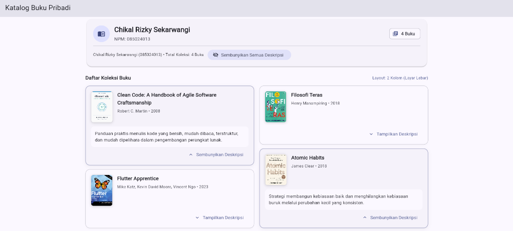
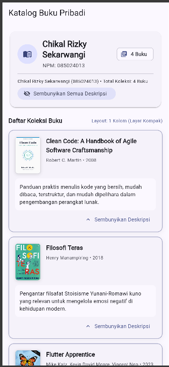
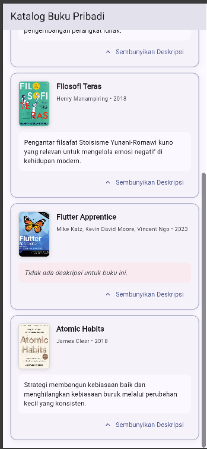

# Aplikasi Katalog Buku

## Identitas Mahasiswa
- Nama: Chikal Rizky Sekarwangi
- NPM: 085024013

## Deskripsi Singkat Aplikasi
Aplikasi Katalog Buku dibangun menggunakan Flutter dengan manajemen state Riverpod. Aplikasi ini menampilkan identitas mahasiswa, jumlah total koleksi buku, serta daftar buku yang mendukung null safety (untuk buku tanpa deskripsi), animasi implisit interaktif, dan tata letak responsif yang menyesuaikan lebar layar perangkat.

## Daftar Fitur Utama
- Manajemen State dengan Riverpod: Menggunakan `nameProvider`, `npmProvider`, `booksProvider`, `infoProvider`, dan `hiddenDescriptionIdsProvider`.
- Informasi Mahasiswa & Koleksi: Menampilkan nama, NPM, dan jumlah total buku secara otomatis.
- Penanganan Null Safety: Buku tanpa deskripsi (`description: null`) ditangani dengan aman tanpa error dan menampilkan pesan fallback.
- Tampil/Sembunyikan Deskripsi: Pengguna dapat menampilkan atau menyembunyikan deskripsi per buku maupun seluruh buku sekaligus.
- Implicit Animation: Menggunakan `AnimatedContainer` dan `AnimatedCrossFade` yang merespons interaksi tombol/kartu buku.
- Tampilan Responsif: Menggunakan `LayoutBuilder` untuk beralih otomatis antara tata letak 1 kolom (layar kecil) dan 2 kolom (layar lebar/landscape).

## Versi Flutter & Langkah Menjalankan Aplikasi
- Versi Flutter: Flutter 3.x (jalankan `flutter --version` di terminal Anda untuk memastikan versi terpasang)
- Langkah Menjalankan:
  1. Clone repository ini:
     ```bash
     git clone https://github.com/chika-sketch/flutter_katalogbuku.git
     cd ets-pemrograman-mobile-2-[NPM]
     ```
  2. Unduh dependensi:
     ```bash
     flutter pub get
     ```
  3. Jalankan aplikasi:
     ```bash
     flutter run
     ```

## Tangkapan Layar Aplikasi

### 💻 Tampilan Desktop
Tampilan responsif pada layar lebar/desktop dengan tata letak 2 kolom otomatis:

<p align="center">
  
</p>

### 📱 Tampilan Mobile
Tampilan responsif pada layar kompak/smartphone dengan tata letak 1 kolom vertikal:

| Tampilan Beranda & Header | Koleksi Buku & Interaksi Deskripsi |
| :---: | :---: |
|  |  |
| *Header Mahasiswa & Navigasi Kolom* | *Interaksi Tampil/Sembunyikan Deskripsi* |


## Video Demonstrasi
- Tautan Video Demonstrasi:(https://drive.google.com/file/d/1GPliJCLsI7YuOGaV6oMf-kcbnl7uvMVo/view?usp=sharing)

## Keterangan Fitur yang Belum Berfungsi
- Seluruh fitur utama telah berfungsi dengan baik.

## Referensi & Keterangan Penggunaan AI
- Referensi:
  - Dokumentasi Resmi Flutter (`AnimatedContainer`, `AnimatedCrossFade`, `LayoutBuilder`): https://docs.flutter.dev
  - Dokumentasi Resmi Riverpod (`flutter_riverpod`): https://riverpod.dev
- Keterangan Penggunaan AI:
  - Alat AI digunakan sebagai asisten referensi untuk menyusun struktur arsitektur folder Riverpod. Seluruh kode telah diuji dan disesuaikan.